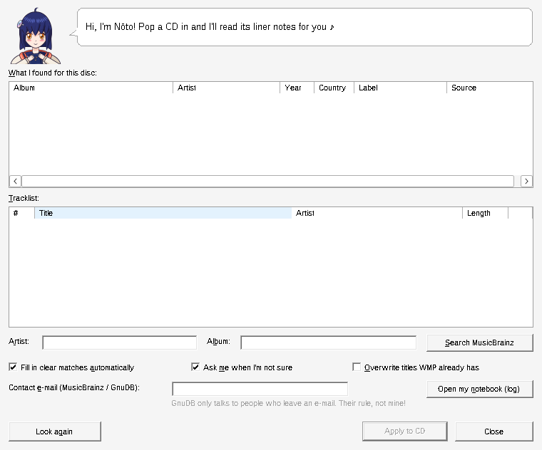

<p align="center">
  
</p>

<p align="center">
  <a href="https://github.com/capstasher/liner-notes/releases/latest"></a>
  
  
  <a href="LICENSE"></a>
</p>

When Microsoft closed Windows Media Player's album-info desk for good, every CD you put
in went back to being *Unknown Album*: Track 1, Track 2, Track 3. **LinerNotes** puts the
names back. It's a small plug-in for WMP 12 that reads your disc, asks
[MusicBrainz](https://musicbrainz.org) (and [GnuDB](https://gnudb.org), if you like) what
it is, and fills in the album, track titles, artists, genre, label and year, the way it
used to just happen.

It's run by **Nōto**.

## Meet Nōto ♪


**Nōto** (ノート) · *LinerNotes-tan*

- **Job:** reads the liner notes, so you don't have to
- **Works at:** the little desk that opened when the old one closed (HTTP 410 Gone)
- **Hair clip:** a CD, obviously
- **Always carries:** headphones, a booklet, and her notebook (your log file)
- **Likes:** discs she's met before, well-tagged releases, one MusicBrainz question a second
- **Dislikes:** "Track 1", scribbling over titles you already have, impolite crawlers
- **Says:** *"Found it!"*

Her name is a double pun: *liner notes* is ライナーノーツ in Japanese, and ノート
(*nōto*) is a notebook, which is where she writes down everything she does.

<br clear="right">

She sits in the corner of the LinerNotes window, and her face follows what she's up to:

|  |  |  |  |
|:---:|:---:|:---:|:---:|
| waiting for a disc | asking MusicBrainz | found it! | couldn't find it… |

Click her if you fancy a chat. *An OS-tan for a media player plug-in, because somebody had to.*

<p align="center">
  
</p>

## Install

1. Download **LinerNotes-1.0.0.zip** from [Releases](https://github.com/capstasher/liner-notes/releases/latest) and unzip it anywhere.
2. Close Windows Media Player.
3. Run **`install.cmd`**. It asks for administrator rights, copies both builds to
   `C:\Program Files\LinerNotes\` and registers them, so it works whether your WMP runs as
   32- or 64-bit.
4. Start WMP and pop a CD in.

Upgrading? Run the new `install.cmd` over the top; there's nothing to remove first.

<details>
<summary>Installing by hand instead</summary>

From an elevated prompt, with the DLLs somewhere permanent (registration points at them
where they sit):

```
C:\Windows\System32\regsvr32 "C:\path\to\LinerNotes64.dll"
C:\Windows\SysWOW64\regsvr32 "C:\path\to\LinerNotes32.dll"
```

</details>

## What she does with your CD

- **She's sure** (one match, or several pressings with identical titles): the names fill
  in a moment after the disc appears.
- **She isn't sure**: her window opens with every candidate and its tracklist, plus an
  artist and album search.
- **WMP already has titles**: she leaves them alone, unless you tick *Overwrite titles WMP
  already has*. *Apply to CD* always writes.
- **A disc she's met before** is filled in straight from her notebook, no internet needed.

Open her window any time from **Tools → Options → Plug-ins → Background → LinerNotes →
Properties**.

> [!TIP]
> WMP's own right-click **Find album info** still points at Microsoft's retired service, so
> it opens a dead web page. That menu item can't be redirected; use Nōto's window instead.

## How she does it

1. Reads the disc's table of contents straight from the drive.
2. Works out its MusicBrainz disc ID and freedb ID from the track offsets, handling the data
   track on Enhanced CDs properly.
3. Asks MusicBrainz for that exact disc, then for near matches by table of contents, then
   for CD stubs. GnuDB is the fallback.
4. Ranks the answers: exact disc ID first, then official releases, your own country's
   pressing, CD formats and labelled releases.
5. Writes them into WMP's CD listing: title and artist per track, album, album artist,
   genre, label, and the album's **original** release year.

She's polite about it: never more than one MusicBrainz request a second, a proper
User-Agent, and she backs off when a server asks her to.

**GnuDB and your e-mail.** GnuDB's protocol needs a contact address, so it stays off until
you type one into her window. The same address goes in the MusicBrainz User-Agent, as
their etiquette asks. It's stored only in `HKCU\Software\LinerNotes`.

**Cover art.** LinerNotes doesn't fetch or write album art. For a cover, copy an image,
right-click the album in WMP's library and choose *Paste album art*; that gives the live
CD its cover too.

## Where things live

| What | Where |
|---|---|
| Program | `C:\Program Files\LinerNotes\` |
| Settings | `HKCU\Software\LinerNotes` |
| Her notebook (log, rotates at 2 MB) | `%LOCALAPPDATA%\LinerNotes\linernotes.log` |
| Discs she remembers (one JSON per disc) | `%LOCALAPPDATA%\LinerNotes\cache\` |

The window speaks in Nōto's voice; the log stays plain English on purpose, because that's
what bug reports are read from.

## Uninstall

Close WMP and run `uninstall.cmd`. Settings, log and cache stay behind; delete
`%LOCALAPPDATA%\LinerNotes` and `HKCU\Software\LinerNotes` to remove those too.

## Building

Needs MinGW-w64 (Linux, WSL or MSYS2):

```
./build-mingw.sh
```

That builds `dist/LinerNotes64.dll` and `dist/LinerNotes32.dll` and runs the portable tests:
disc ID golden vectors, the JSON reader, MusicBrainz and GnuDB parsers, ranking, the
cache, and every line Nōto can say (valid UTF-8, sensible length, right mood, and only
glyphs a stock Windows font can draw).

`src/core` is portable C++17; `src/win` is the COM, WinHTTP, CD-ROM and window code. The
DLLs import nothing but stock Windows system libraries.

Builds are reproducible: the same commit built with the same toolchain gives byte-identical
DLLs, so you can rebuild a release and check it against the SHA-256 sums published with it.
Releases are built with Ubuntu 24.04's MinGW-w64 (GCC 13), the same as CI.

Nōto is drawn entirely in code, in outlined, cel-shaded style: [`art/noto.py`](art/noto.py)
lays out the shapes and [`art/brush.py`](art/brush.py) turns centre-lines into tapered ink
strokes. Run `python3 art/build_assets.py` (needs Pillow and Playwright's Chromium) to
regenerate the sprites in `res/`, the icon and the images in `docs/`. The SVGs in `art/` open
with named layers (hair, face, eyes, body…) in Inkscape or Krita, if you'd rather touch her up
by hand.

## Credits

- Disc and release data from [MusicBrainz](https://musicbrainz.org) (CC0) and
  [GnuDB](https://gnudb.org).
- Nōto is an original character. The banner's lettering is
  [M PLUS Rounded 1c](https://fonts.google.com/specimen/M+PLUS+Rounded+1c) (SIL OFL).

## Licence

MIT, see [LICENSE](LICENSE). Nōto's artwork is covered by the same licence, so feel free to
draw her too.
